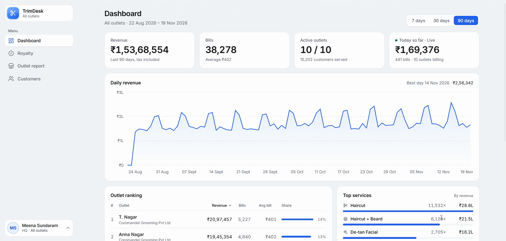
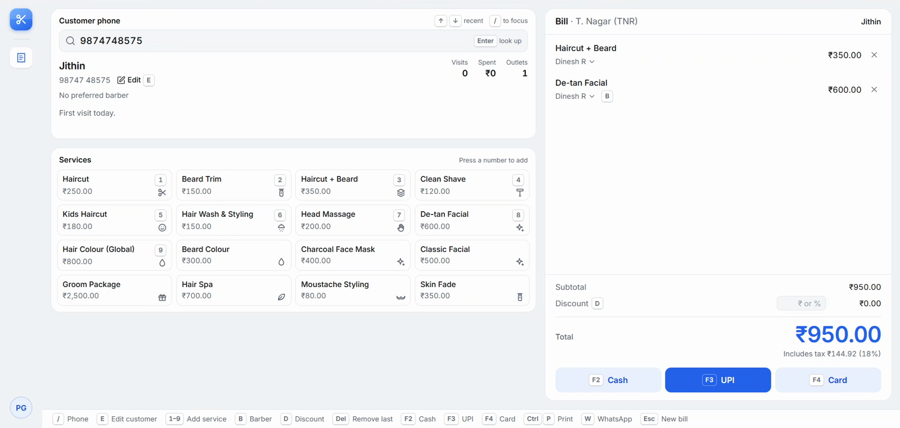

# TrimDesk

**Multi-outlet billing and franchise analytics for men's grooming chains.**

TrimDesk is a full-stack point-of-sale and head-office reporting platform. I built it independently after spotting a gap at a 170+ outlet men's grooming franchise that still bills on Excel. It's a working prototype; the franchise hasn't adopted it.

🔗 **Live demo:** [trimdesk.up.railway.app](https://trimdesk.up.railway.app) · 🎥 **Demo video:** [YouTube](https://youtu.be/883OPWghbuM)





## Features

- **Fast, keyboard-only billing:** completes a customer bill in under 20 seconds, with tax-inclusive GST, barber commissions and thermal receipt printing.
- **Role-based access:** HQ, franchise owner, manager and cashier roles using JWT, with data scoping enforced in the service layer.
- **Live HQ dashboard:** sales across outlets at a glance.
- **Franchise royalty reports:** generated automatically each month, with CSV export (demo runs on 90 days of seeded data).
- **Security basics:** BCrypt password hashing, request validation, Spring Security's default secure HTTP headers, a rate-limited client error-report endpoint, and a production profile that refuses to start with the development JWT secret.

## Tech stack

| Layer | Technology |
|---|---|
| Backend | Java 21, Spring Boot 3.5, Spring Security (JWT via OAuth2 Resource Server), Spring Data JPA / Hibernate, Bean Validation |
| Database | PostgreSQL 16, Flyway migrations |
| Frontend | React 18, TypeScript, Vite, Tailwind CSS, TanStack Query, React Router, Recharts |
| Testing | JUnit 5 (billing, commission, royalty, bill numbering and role-scope rules) |
| Deployment | Docker (one image serves the API and the built frontend), Railway |
| Analytics | Umami (privacy-friendly) |

## Architecture

```
React + TypeScript (Tailwind)
        │  REST / JSON, JWT
        ▼
Spring Boot 3 API ── role-based access, data scoping in the service layer
        │
        ▼
PostgreSQL (schema managed by Flyway)
```

In production a single Docker image builds the frontend and serves it from Spring Boot, so the browser and API share one origin.

## Run it locally

Requires Java 21, Node 22 and Docker.

```bash
# 1. Database (PostgreSQL 16 on localhost:5432)
docker compose up -d

# 2. Backend on http://localhost:8081
#    The "seed" profile fills an empty database with 90 days of demo data on first start.
cd backend
SPRING_PROFILES_ACTIVE=seed ./mvnw spring-boot:run

# 3. Frontend on http://localhost:5173 (proxies /api to the backend)
cd frontend
npm install
npm run dev
```

Demo logins (seeded data only): `hq`, `owner1`, `manager_<outlet code>`, `cashier_<outlet code>`, password `demo123`. The login page also has one-click demo buttons.

### Environment variables

Local runs work with the built-in development defaults. A deployment sets these (names only, never commit values):

| Variable | Purpose |
|---|---|
| `SPRING_PROFILES_ACTIVE` | `prod` in production (add `seed` for demo data) |
| `DB_URL`, `DB_USER`, `DB_PASSWORD` | PostgreSQL connection |
| `JWT_SECRET` | Token signing key, 32+ bytes (required in production) |
| `CORS_ORIGINS` | Extra allowed origins, comma-separated (optional) |
| `PORT` | HTTP port (set by the host) |

See [DEPLOY.md](DEPLOY.md) for the Railway setup.

## Testing

```bash
cd backend
./mvnw test
```

Unit tests cover the core business rules: GST calculation, barber commissions, franchise royalties, bill numbering and role-based data scoping.

## Author

**Hashim Khan N** · Backend Engineer (Java, Spring Boot) · [Portfolio](https://itshashi7.github.io/hashi-portfolio/) · [LinkedIn](https://linkedin.com/in/hashim-khan-7b07b3223)
